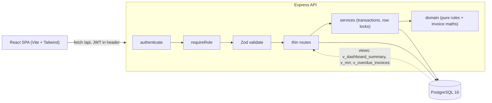
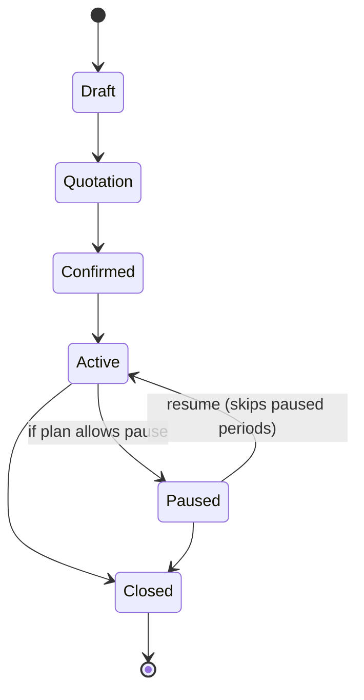
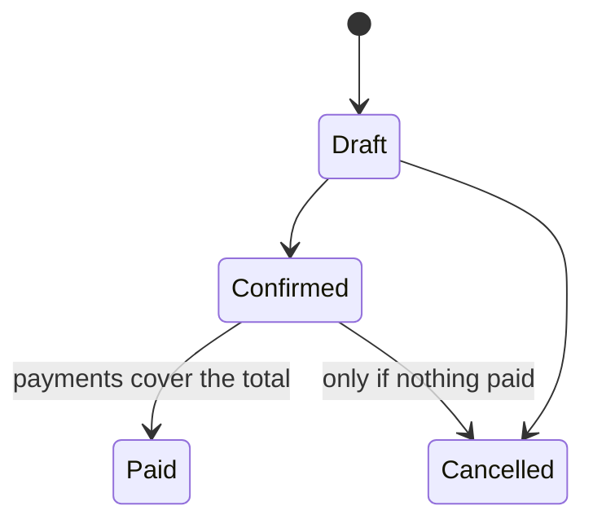
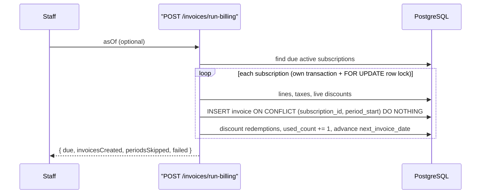

# Brightloop — Subscription Management System

A unified subscription-billing platform: products and plans, quotation-to-subscription,
automatic recurring invoicing, discounts, payments and a finance dashboard.

Built for the **Odoo x FLUX Lucknow Hackathon '26**. Problem statement: *Subscription Management System*.

**Stack:** Node 20 · Express 4 · PostgreSQL 16 · Zod · JWT · React 18 · Vite · Tailwind · Recharts.
Custom REST API over a real relational database. No static JSON, no BaaS — every form, status change
and chart reads from or writes to PostgreSQL.

The application lives in [`brightloop-api/`](./brightloop-api). This file is the map; the full technical
README is [`brightloop-api/README.md`](./brightloop-api/README.md).

---

## Run it (one command)

```bash
cd brightloop-api
docker compose up --build
```

This starts PostgreSQL, seeds it (1,500 customers, 5,000 subscriptions, ~12k invoices),
and serves the API **and** the built web app together on <http://localhost:3000>.

API docs (OpenAPI): <http://localhost:3000/api/docs> · Health: <http://localhost:3000/api/health>

### Local development

```bash
cd brightloop-api
npm install
npm run db:seed          # needs a PostgreSQL on DATABASE_URL (see .env.example)
npm start                # API on :3000
npm test                 # 20 unit tests

cd frontend
npm install
npm run dev              # web app on :5173, proxies /api to :3000
```

### Demo logins

| Role | Email | Password | Sees |
|---|---|---|---|
| **Admin** | `admin@brightloop.test` | `Admin@12345` | Everything, incl. catalogue + staff setup |
| **Staff** | `staff@brightloop.test` | `Staff@12345` | Day-to-day: subscriptions, invoices, payments |
| **Customer** | `customer@brightloop.test` | `Customer@123` | Portal: only their own subscriptions + invoices |

The seed deliberately leaves periods due **today** unbilled, so **Run Billing** has real work on first use.

---

## What it does

- **Accounts & roles** — one account per email (case-insensitive), strong-password rule, email reset link.
  Three roles: admin, staff, customer. Only admin adds staff.
- **Catalogue** — products with variants (e.g. Brand = Odoo adds ₹560), plans (daily/weekly/monthly/yearly
  billing, min quantity, availability window, and per-plan flags: auto-close, early close, pause, renew),
  taxes, quotation templates.
- **Subscriptions** — created from a template or explicit lines; move through
  Draft → Quotation → Confirmed → Active → Closed, with a snapshot unit price per line.
- **Automatic recurring billing** — one invoice per subscription per period, taxes applied automatically,
  **nothing billed twice or skipped**.
- **Discounts** — fixed or percentage, thresholds, date window, usage limit, product- or subscription-scoped;
  appear on the next invoice automatically and stop when expired or used up.
- **Payments** — method, amount, date, note, against the right invoice; invoice flips to Paid when settled.
- **Finance dashboard** — active subscriptions, revenue, outstanding, overdue, MRR; revenue chart;
  overdue table; CSV export. Sub-2-second lists over thousands of rows.

---

## Architecture (3-tier)



Business logic stays in `src/domain` (pure, unit-tested) and `src/services` (transactional).
Routes are thin. Input is validated by Zod; SQL is always parameterised.

## Subscription lifecycle



## Invoice lifecycle



Illegal transitions return **409**. Paid is reachable only by recording payments, never by a direct status set.

## Billing day — why nothing is billed twice



The `UNIQUE (subscription_id, period_start)` constraint plus a per-subscription row lock make billing
**idempotent**: run it twice and the second run creates zero invoices and reports the periods as skipped.
Missed periods are caught up on the next run.

---

## Verification status

Verified against a live PostgreSQL (not just syntax-checked):

- ✅ 20/20 unit tests pass (`npm test`)
- ✅ All three seed logins succeed; role scoping enforced (customer → 403 on staff routes)
- ✅ Heavy lists over 5,000 subscriptions respond in ~20–40 ms (requirement: under 2 s)
- ✅ **Billing idempotency**: first run created 429 invoices; second run created **0**
- ✅ Admin create flows (product + Odoo +560 variant, plan + flag toggle, tax, discount, staff) all succeed
- ✅ Payments list + filters, reset-password flow, revenue report (day & month) all work
- ✅ Frontend builds clean and is served from the API origin

---

## Repository layout

```
brightloop-api/
  db/            schema.sql, seed.js
  src/
    domain/      pure business rules + invoice maths (no DB)
    services/    billing + lifecycle (transactions)
    middleware/  auth, validate, errors
    routes/      auth, users, catalog, subscriptions, invoices, payments, reports
  test/          unit tests
  frontend/      React + Vite + Tailwind app
  docker-compose.yml  Dockerfile  .env.example
```

## Team

| Role | Member |
|---|---|
| Team Leader — PM, portal, repo admin | @vikassharma270907-alt |
| Frontend / architecture / presentation | @icametexploree |
| Backend / logic / APIs | Ansh Shrivastav |
| Fullstack / testing / video demo | @pramodsonihere |
