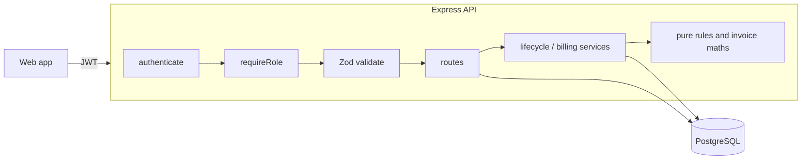
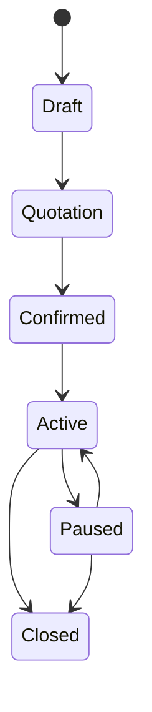
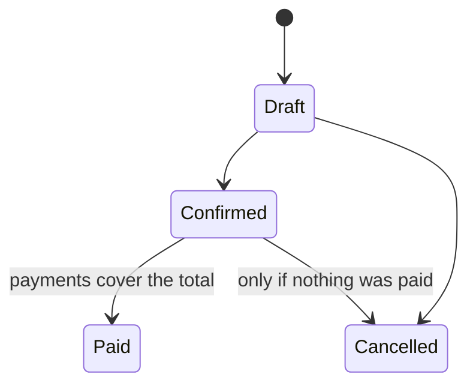
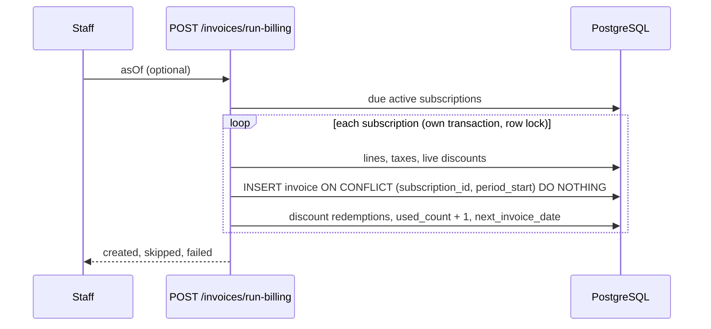

# Brightloop Subscription Management System: API

Plans, subscriptions, recurring billing, payments and revenue reporting on **Node + Express + PostgreSQL**.
Everything is read from and written to the database. There are no static JSON files and no BaaS.

## Run it

```bash
docker compose up --build        # Postgres + seed (1,500 customers, 5,000 subscriptions) + API on :3000
# or locally
cp .env.example .env && npm install && npm run db:seed && npm start
npm test
```

API docs: <http://localhost:3000/api/docs>

## Frontend (`frontend/`)

React 18 + Vite + Tailwind + React Router + Recharts. Docker serves the built app from the API at <http://localhost:3000>.

```bash
cd frontend && npm install && npm run dev      # http://localhost:5173, proxies /api to :3000
```

Built: sign-in, sign-up (live password checklist) and forgot-password; role-guarded routes; finance dashboard (KPIs, revenue chart, overdue table, CSV export, 30-second refresh); subscriptions (filters, create from template, lifecycle buttons that show only legal next states, renew); invoices (filters, Run Billing, confirm, cancel, send, print, record payment); customer portal; offline banner with cached reads.
Still to build: reset-password page, admin screens (products with variants, plans, taxes, discounts, templates, staff), payments list.

| Role | Login | Password |
|---|---|---|
| Admin | admin@brightloop.test | Admin@12345 |
| Staff | staff@brightloop.test | Staff@12345 |
| Customer | customer@brightloop.test | Customer@123 |

## Architecture



## Subscription lifecycle



## Invoice lifecycle



## Billing day



## Rules enforced

* **Sign-up:** one account per email (case-insensitive unique index); the password needs more than 8 characters, an uppercase letter, a lowercase letter and a special character.
* **Roles:** only the admin adds staff and creates plans, products, taxes, discounts and templates. Staff run daily work. Customers see only their own subscriptions and invoices, and can pause, resume or close their own subscription.
* **Nothing is billed twice or skipped:** `UNIQUE (subscription_id, period_start)`, plus row locks and catch-up of missed periods.
* **Discounts:** applied automatically on the next invoice, and they stop when they expire or run out.
* **Tax:** calculated after discounts, from admin-defined rules.
* **Invalid input:** returns `400` with field-level errors. Illegal state changes and overpayments return `409`.
* **Speed:** every list is paginated (max 100), filters use indexes, and dashboard figures come from SQL views.

## Endpoints

See `/api/docs`. The main ones:
`POST /auth/signup|login|forgot-password|reset-password`, `POST /users/staff`,
`/products /plans /taxes /discounts /templates`, `/subscriptions` (`/transition`, `/renew`),
`POST /invoices/run-billing`, `/invoices` (`confirm`, `cancel`, `send`, `print`), `/payments`,
`/reports/summary|revenue|overdue|status-breakdown|export.csv`.

## Known limits

* A deactivated user keeps a valid token until it expires (default 8 hours).
* The reset e-mail prints to the server log unless `SMTP_URL` is set.
* No login rate-limiting yet.
